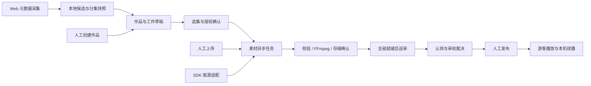

# 映刻短剧 · OpenDuanju

[](https://github.com/ayermac/openduanju/actions/workflows/ci.yml)
[](server/go.mod)
[](web/package.json)
[](LICENSE)

一个前后端分离的短剧内容管理与播放平台：从来源采集、本地选剧、素材处理，到审核发布和游客续播，在同一个仓库维护运营后台、消费端网站与 Go 服务端。

**当前阶段：首版开发预览。** 本地存储下的业务流程与五服务 Docker 部署已验证；真实 SDK 视频获取和腾讯云 COS 集成尚未完成外部验证。项目不附带第三方作品视频、来源账号或存储凭据。

[快速开始](#快速开始) · [架构](docs/architecture.md) · [部署说明](deploy/README.md) · [开发与测试](docs/development.md) · [已知限制](docs/known-limitations.md)

## 能做什么

| 模块       | 已实现能力                                                                                        |
| ---------- | ------------------------------------------------------------------------------------------------- |
| 来源与通道 | 配置、版本校验、启停、显式测试连接；适配器声明可执行入口，目前为红果 Web 热播榜                   |
| 异步采集   | 榜单、作品详情、分集元数据；请求/条目预算、分钟限频、cron、页检查点、租约接管、取消和重试         |
| 本地候选   | 分页检索、完整快照、只读详情、导入作品及分集选择；完整快照不依赖即时来源请求                      |
| 内容管理   | 候选导入/人工创建、工作草稿、版本冲突保护、新修订、继承素材及驳回重提                             |
| 素材处理   | 上传会话、封面校验、异步视频处理、阶段恢复、对象身份确认；FFmpeg 按需转封装/转码为 MP4/H.264/AAC  |
| 审核发布   | 全部选中素材与封面就绪后送审、审核认领、禁止自审、检查项、发布/下架及原因审计                     |
| 后台权限   | 管理员、运营、审核员；Cookie 会话、CSRF、登录限流，HTTP/gRPC 共用能力规则                         |
| 游客播放   | 已发布内容、搜索/分类、选集、倍速、播放凭证刷新、本设备分集与位置恢复                             |
| 审计与排查 | 关键写入与成功审计同事务，失败留痕；请求、错误和异步任务通过 trace 编号关联；签名媒体路径日志脱敏 |

元数据采集与视频获取是两条独立能力：**Web 适配器负责目录和分集身份，SDK 适配器只负责后台视频取源。** 游客播放已处理、已审核的自有存储素材，不在播放请求中访问来源 SDK。

## 业务流程



新修订不直接改写在架内容；已发布修订冻结元数据、选集和素材引用。授权到期、撤销或内容下架后，公开查询与新播放凭证会被重新校验。已签发存储链接不承诺立即失效。

## 技术栈与目录

| 部分       | 技术                                          | 目录                                             |
| ---------- | --------------------------------------------- | ------------------------------------------------ |
| 运营后台   | Vue 3、TypeScript、Vite、Element Plus         | [admin](admin/README.md)                         |
| 消费端网站 | Vue 3、TypeScript、Vite、Pinia                | [web](web/README.md)                             |
| 服务端     | Go、Kratos v3、Wire、Ent、Protobuf、HTTP/gRPC | [server](server/README.md)                       |
| 数据与任务 | MySQL 8.4、显式 SQL 迁移、持久化任务与租约    | [server/migrations](server/migrations)           |
| 媒体       | FFmpeg/ffprobe、本地对象存储、COS 适配器      | [媒体实现](server/internal/data/media_ffmpeg.go) |
| 交付       | Docker Compose、两个独立 Nginx 前端镜像       | [deploy](deploy/README.md)                       |

Redis 7.4 随开发栈部署并预留配置；**当前业务缓存、采集限频与任务领取没有依赖 Redis，预算与分钟窗口保存在 MySQL。**

```text
.
├── admin/             # 运营后台
├── web/               # 游客网站
├── server/
│   ├── api/           # Protobuf、HTTP/gRPC 生成代码
│   ├── cmd/           # 服务、迁移、初始化及专项工具
│   ├── internal/      # server → service → biz → data
│   ├── migrations/    # 版本化 SQL 迁移
│   └── configs/       # 无真实凭据的运行配置
├── deploy/            # Docker Compose 与 Nginx
├── scripts/           # 生成检查、测试与运行验证
└── docs/              # 公开架构、开发说明、限制和截图
```

Go 不渲染页面，也不嵌入前端产物。两个前端分别构建，由各自 Nginx 托管。

## 快速开始

推荐先走 **人工创建作品 + 人工上传 + local 存储**，不需要 SDK 身份或 COS 密钥。

需要 Docker Engine/Docker Desktop 与 Docker Compose v2；下面用 Python 3 隐藏输入管理员初始密码。

```bash
git clone https://github.com/ayermac/openduanju.git
cd openduanju
cp .env.example .env
```

编辑 `.env`，替换 `MYSQL_ROOT_PASSWORD` 与 `MYSQL_PASSWORD`，其余可先保留默认值。不要使用真实生产数据库。

```bash
# 1. 构建三个应用镜像，启动数据库与 Redis
 docker compose --env-file .env -f deploy/compose.yaml build server admin web
 docker compose --env-file .env -f deploy/compose.yaml up -d --wait mysql redis

# 2. 显式迁移；必须覆盖镜像默认的 server entrypoint
 docker compose --env-file .env -f deploy/compose.yaml run --rm --no-deps \
  --entrypoint /app/migrate server -conf /app/configs -up

# 3. 一次性创建管理员；密码从标准输入读取，无内置默认密码
python3 -c 'import getpass; print(getpass.getpass("管理员初始密码："))' | \
  docker compose --env-file .env -f deploy/compose.yaml run --rm -T --no-deps \
  --entrypoint /app/staff-init server -conf /app/configs -username admin

# 4. 启动服务与两个前端
 docker compose --env-file .env -f deploy/compose.yaml up -d server admin web
```

| 入口     | 默认地址               |
| -------- | ---------------------- |
| 运营后台 | http://127.0.0.1:18081 |
| C 端网站 | http://127.0.0.1:18082 |
| HTTP API | http://127.0.0.1:18000 |
| gRPC     | `127.0.0.1:19000`      |

初次启动没有作品，C 端显示空状态。管理员登录后创建运营与审核员账号，再从「内容管理」人工创建作品、上传视频和封面、配置授权、提交处理、使用另一账号审核，最后发布。管理员也不能审核自己提交的内容。

详细环境配置、端口、日志和升级步骤见 [部署说明](deploy/README.md)。

## 开发与验证

本机工具版本见 [.tool-versions.json](.tool-versions.json)：Go 1.26.2、Node 22.23.5、npm 12.0.2；媒体检查还需要 FFmpeg/ffprobe，浏览器测试需要 Playwright Chromium。

```bash
make install
npm exec -- playwright install chromium
make check
```

`make check` 覆盖静态检查、单元/竞态测试、生成一致性、媒体冒烟及前端浏览器用例；**不等于执行了真实数据库、来源或 COS 验收**。数据库目标使用专门的一次性测试库，例如：

```bash
make test-content MIGRATE_TEST_DSN='test_user:test_password@tcp(127.0.0.1:13380)/openduanju_content_test?parseTime=true&loc=UTC'
```

测试会清理目标表，不能传入正在使用的开发或业务库。完整目标和本机启动方式见 [开发与测试](docs/development.md)。

## 当前边界

- 本地存储下的完整业务链路已验证，不能据此承诺生产容量或可用率。
- SDK 真实播放解析返回空结果并映射为 `ErrAnonymousLimited`，原因未进一步证实；不能承诺换身份即可解决。
- COS 适配器与配置已提供，但真实桶上传、版本绑定和播放尚待外部验证。
- 目前只有红果 Web 热播榜入口；新增网站需要实现并注册适配器，不支持任意 URL 或动态代码采集。
- 观看进度仅保存在本设备；账号、跨设备同步、IAA 广告与归因、运营看板未实现。

更多未完成项与非阻断问题见 [已知限制](docs/known-limitations.md)。功能演进见 [CHANGELOG](CHANGELOG.md)。

## 协作与许可证

贡献前请阅读 [CONTRIBUTING](CONTRIBUTING.md) 与 [AGENTS.md](AGENTS.md)。公开运行与测试说明在 `docs/`；内部产品决策、任务及原始验收资料 `.doc/` 不随仓库分发，不影响按公开说明运行项目。

项目采用 [MIT License](LICENSE)。Kratos 模板的原版权与许可保留在 [server/LICENSE](server/LICENSE)，其他第三方依赖保留各自许可。请仅处理和发布已获授权的媒体；仓库代码许可不包含第三方内容的使用授权。
