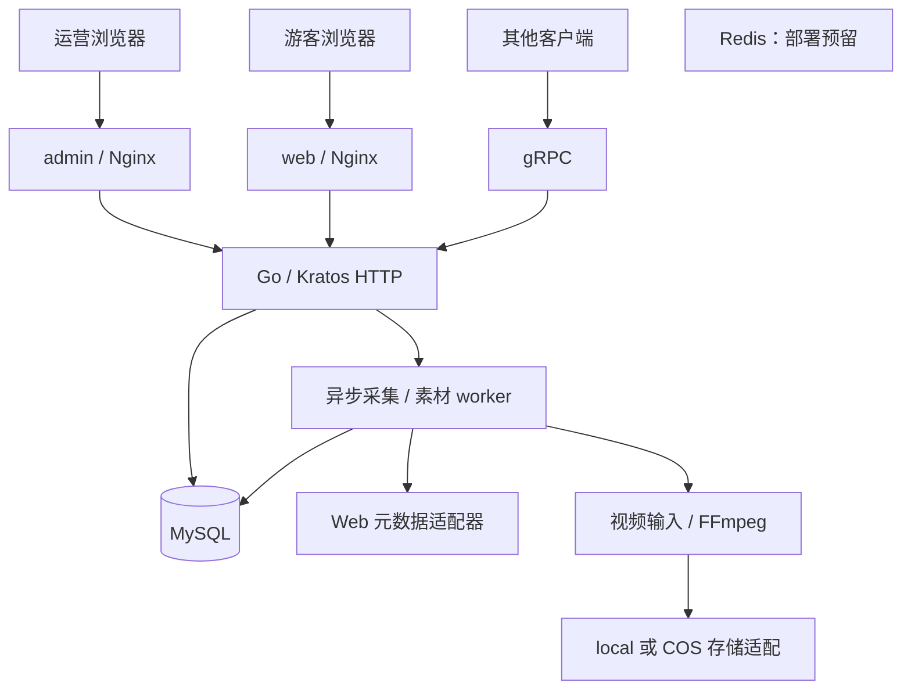

# 架构与数据流程

[返回项目首页](../README.md)

## 五服务部署

前端通过相对 `/api/` 访问同域 Nginx，由代理转发到 server。两端分别构建，不把 Vue 产物嵌入 Go。当前 Redis 没有业务客户端依赖，任务队列、租约和采集预算均持久化到 MySQL。

## 服务端分层

| 层                  | 职责                                           |
| ------------------- | ---------------------------------------------- |
| `api/`              | Protobuf 契约、生成的 HTTP/gRPC 接线与错误约定 |
| `internal/server/`  | 传输、鉴权、CSRF、Trace、响应编码              |
| `internal/service/` | DTO 与领域对象转换                             |
| `internal/biz/`     | 用例、状态规则、仓储接口及错误分类             |
| `internal/data/`    | Ent 仓储、数据库事务、来源与存储适配器         |
| `cmd/`              | Wire 装配、服务入口、迁移及一次性初始化命令    |

数据库结构由显式 SQL 迁移维护，Ent schema 提供类型化实体访问；运行服务不会自动执行业务迁移。已应用迁移不改写。

## 内容对象

- **候选**：来源目录的本地快照，包含元数据和分集身份。完整候选导入时不即时访问来源。
- **作品**：站内内容身份，支持来源导入或人工创建。人工作品不伪造来源外部 ID。
- **修订**：元数据、选集、输入及素材引用的版本。只有当前工作草稿可编辑；发布后修改需要新修订。
- **授权依据**：作品级处理、展示、播放权限和期限；提交冻结依据身份，后续关键节点动态复核。
- **素材批次与任务**：按修订冻结选集，逐集解析/获取、校验、处理、上传、确认；已确认产物可按输入及处理规格复用。
- **审核任务与决定**：全部选中视频和封面就绪后产生；认领人与提交人不同，决定不可覆盖。
- **发布**：冻结已批准修订；再次发布递增代次，防止旧播放会话被重新激活。
- **播放会话**：固定发布、修订、分集及对象版本；刷新只重新签发同一素材访问凭证。

## 异步可靠性

任务采用至少一次执行与幂等事务。worker 领取带租约，续期失败或过期接管后，旧 worker 的写入由身份、代次及到期时间校验拒绝。

采集在外呼前预占请求预算，分钟额度耗尽进入等待，总预算耗尽需显式追加后恢复。页检查点用于续跑；候选与对应尝试结果在事务中保存。当前不是所有候选写入与整个页检查点共用一个大事务。

素材任务保存阶段及可复用产物身份，恢复时核对文件、大小、摘要与对象版本，不将“曾上传成功”当作本次对象仍有效。

## 权限与审计

| 角色   | 内容/采集/素材 | 授权与账号管理       | 审核         | 发布/下架 |
| ------ | -------------- | -------------------- | ------------ | --------- |
| 管理员 | 可写           | 可写                 | 可认领与裁决 | 可以      |
| 运营   | 可写           | 只读核验             | 只读         | 可以      |
| 审核员 | 业务读取       | 业务读取，不管理账号 | 可认领与裁决 | 不可以    |

页面入口按角色调整，最终权限在服务端。三角色都不能绕过对象归属、状态、版本校验；管理员也不能自审。

关键成功审计与业务写入同事务，写审计失败会回滚业务；业务失败在回滚后独立记录，保留原错误。Trace 关联请求、错误、日志和异步任务。这里是基础关联机制，不是完整的 OpenTelemetry Span 追踪或独立告警平台。

## 接口与扩展

- 管理端：[`server/api/admin/v1/admin.proto`](../server/api/admin/v1/admin.proto)
- 公开端：[`server/api/web/v1/web.proto`](../server/api/web/v1/web.proto)
- OpenAPI：[`server/openapi.yaml`](../server/openapi.yaml)
- 配置：[`server/internal/conf/conf.proto`](../server/internal/conf/conf.proto)

元数据入口由已注册适配器声明；视频 resolver 与对象存储接口可替换。新增来源仍需实现、注册、配置与测试，不能仅在页面输入新域名就自动支持。
